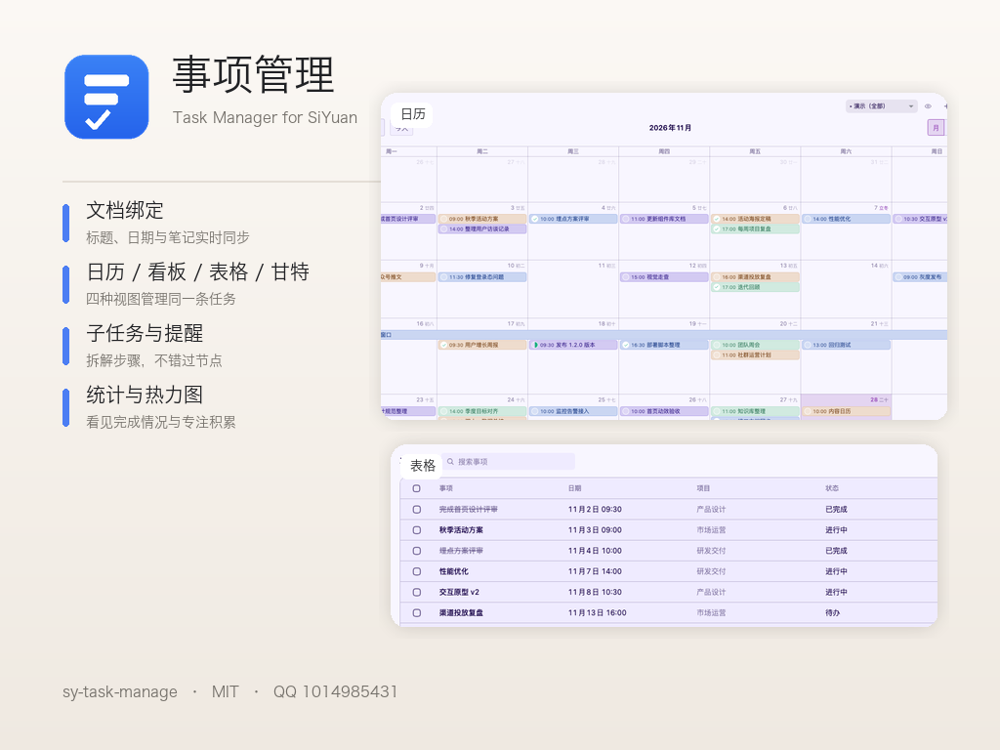
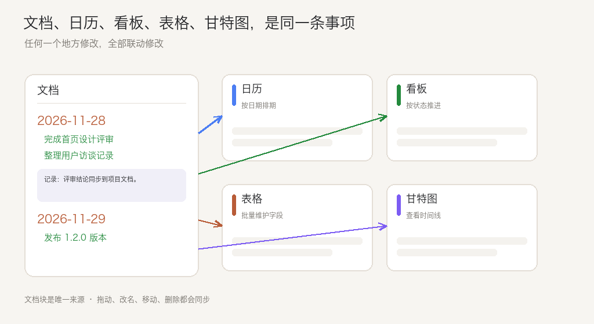
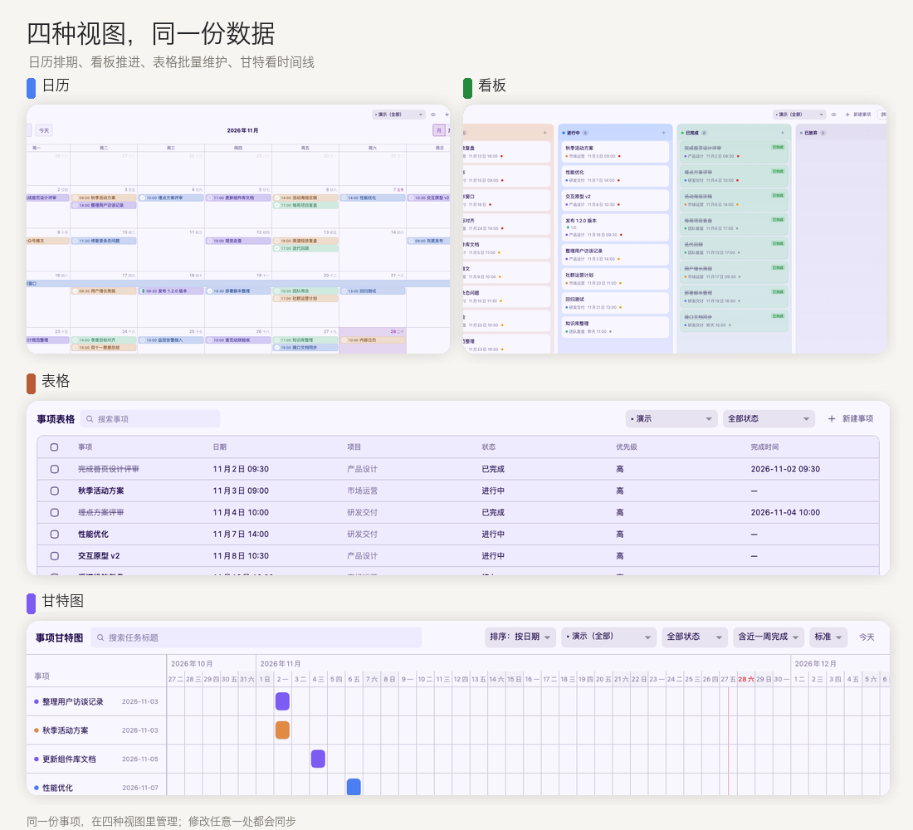

> 欢迎 QQ 群 1014985431 沟通交流、反馈 bug、提交需求。

# Task Manager for SiYuan (`sy-task-manage`)

Documents, calendar, kanban, table and Gantt — one shared source of tasks.



## Quick start

1. **Install** — search for “Task Manager” in the SiYuan marketplace, install and enable it. A task icon appears in the sidebar.
2. **Create** — use quick add in the sidebar, or click `+` for all fields; you can also use **Block menu → Plugins → Set as task** in a document.
3. **Switch views** — use the bottom bar to open Kanban, Calendar, Gantt or Table.

> Quick add only creates a task. Use `+` when you need a project, note or document binding.

## The document is the source

Tasks are bound to document blocks. Document, calendar, kanban, table and Gantt are different entries to the same task data:

- A task block under a date heading appears on that date in the calendar
- Dragging a task in the calendar moves the block to the new date heading
- Editing, moving or deleting a bound block updates every view

<p align="center"></p>

## Multiple views, one data set

<p align="center"></p>

| View | Best for |
| --- | --- |
| Calendar | Schedule by date, drag to reschedule, select multiple days |
| Kanban | Move tasks through todo / doing / done / abandoned |
| Table | See fields together, multi-select and bulk changes |
| Gantt | Project timeline and multi-day planning |

## Features

### Core

- **Tasks and projects** — create, edit, complete, abandon and search tasks; group projects by category.
- **Document integration** — bind any block as a task; title edits, block moves and deletes update every view; creating from calendar/kanban writes into the project document.
- **Subtasks** — add subtasks with progress; when the parent is bound, they become a task list under the parent block and stay in sync with document checkboxes.
- **Quick add** — type a title and press Enter; natural dates such as “tomorrow 10:00” are supported.
- **Auto collection** — new task-list items under a date heading can become tasks automatically; H5/H6 heading collection is optional.

### Views

- **Calendar** — month/week/list; lunar dates; drag to reschedule, resize multi-day tasks, complete from an event.
- **Kanban** — four columns with drag-and-drop status changes, category and project filters.
- **Table** — multi-select, bulk complete/reopen, bulk project/date changes and bulk delete.
- **Gantt** — search, sort, status and completion filters; drag bars to shift dates.

### Productivity

- **Reminders** — on time, 5/10/15/30 minutes before, or 1/2 hours before; in-app feedback plus a system notification attempt. Catch-up after long periods offline is limited.
- **Pomodoro** — 25-minute focus sessions with automatic 5/15-minute breaks, pause/resume and per-task counts.
- **Statistics** — task, project and pomodoro summaries; task-completion and pomodoro heatmaps support 30 days, 90 days, 6 months and 12 months, default to 12 months, and can be filtered by project.
- **Repeating tasks** — daily, weekly, monthly or yearly with interval and end date.

### Data and display

- **Import/export** — JSON backup and restore; legacy task-plugin import is supported.
- **Privacy mode** — masks task and project names in calendar and kanban; the sidebar and table still show plain text.
- **Settings** — click the gear in the sidebar, or the settings gear on the marketplace plugin card.

## Installation

### Marketplace

Open *Settings → Marketplace*, search for **事项管理** (Task Manager), install and enable it.

### Manual

Download `package.zip` from the latest GitHub release and extract it into:

```text
{workspace}/data/plugins/sy-task-manage/
```

Then enable the plugin in *Settings → Marketplace → Downloaded*.

## Usage

### Create a task

- **Quick add** — type a title in the sidebar and press Enter; creates a task only
- **Full create** — click `+` to set project, date, time, reminder and note
- **From a document** — use **Block menu → Plugins → Set as task** to bind the task to that block

### Bind a document block

Click a task title to jump to its block; click elsewhere in the row to edit. Task title and date stay in sync with the block.

### Switch views

- **Calendar** — month, week and list; drag to reschedule or select multiple days
- **Kanban** — drag cards between statuses; filter by project or category
- **Table** — multi-select and bulk complete, reopen, change project/date or delete
- **Gantt** — view the timeline and drag bars to move dates

### Subtasks

Add subtasks in the task dialog. When the parent is bound to a document block, subtasks become a task list in the document and checkboxes sync both ways.

Settings → Tasks & documents → Subtask parent style supports Auto, H5 or H6; the H5/H6 buttons in the subtask section convert only the current parent.

### Reminders, Pomodoro and document mentions

- Set start/end time and a reminder offset while creating or editing a task
- Hover a task row to start a Pomodoro
- Type `@name` in a document to insert a contact link
- Type `@today` / `@tomorrow` / `@2026-11-18` to insert a date heading; the typed `@date` text is removed automatically

## Use with Mankeep

[Mankeep](https://github.com/ccztao/siyuan-mankeep) is the companion contact/relationship manager for SiYuan. This plugin reads contact documents from Mankeep:

- Type `@name` in a task to link a contact
- Type `@name` in a document to insert a contact link
- Keep contacts, dates and tasks together in the same document

The two plugins are designed to work together and are recommended as a pair.

## Requirements

- SiYuan **3.1.0** or newer (desktop and web).
- Optional: a notebook named **Mankeep** or **人脉** containing contact documents for `@` mentions.

## Data

Tasks, projects and settings are stored in SiYuan's plugin data directory. Use **Settings → Data** to import/export JSON or import legacy task-plugin data.

## License

MIT. See [LICENSE](LICENSE).
