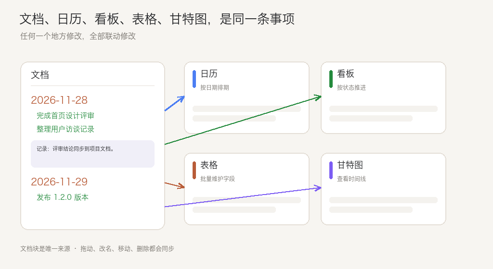
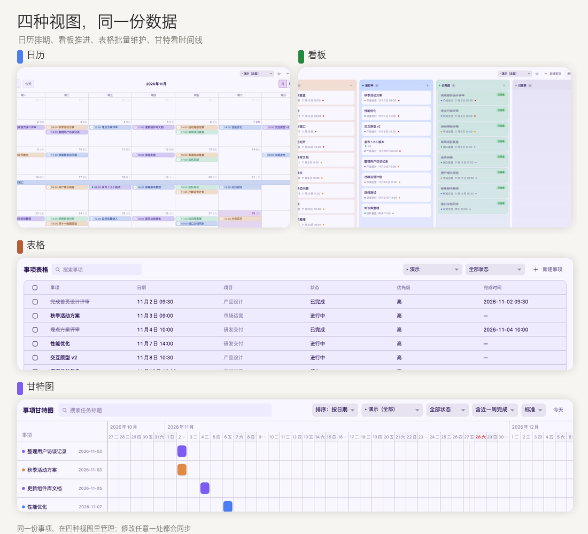

> 欢迎 QQ 群 1014985431 沟通交流、反馈 bug、提交需求。

# 事项管理（sy-task-manage）

文档、日历、看板、表格、甘特图，共用同一份事项数据。


## 三步开始

1. **安装**：在思源集市搜索「事项管理」安装并启用，左侧出现「事项」图标。
2. **创建**：在侧栏快速添加，或点击「+」填写完整信息；也可以在文档块菜单中选择「插件 → 设为事项」。
3. **查看**：在底部切换「看板 / 日历 / 甘特 / 表格」。

> 快速添加只创建事项，不设置项目、备注和文档绑定；需要这些信息时请用「+」完整新建。

## 文档是数据源

事项绑定在文档块上。文档、日历、看板、表格和甘特图不是五份数据，而是同一份事项的不同入口：

- 文档日期标题下的任务块，会出现在对应日期的日历里
- 在日历拖动事项，文档里的块会移动到新的日期标题下
- 修改、移动或删除绑定块，其他视图同步更新

<p align="center"></p>

## 同一份数据的多个视图

<p align="center"></p>

| 视图 | 适合做什么 |
| --- | --- |
| 日历 | 按日期看排期、拖动改期、拖选多天 |
| 看板 | 按待办 / 进行中 / 已完成 / 已放弃推进事项 |
| 表格 | 集中查看字段，多选、批量改项目/日期/状态 |
| 甘特图 | 看项目时间线和跨天安排 |

## 功能

### 核心

- **事项与项目**：新建、编辑、完成、放弃、搜索事项；项目按分类分组。
- **文档联动**：任意块可设为事项；修改标题、移动块、删除块会同步到所有视图；日历/看板新建事项时会写入项目关联文档。
- **子任务**：在事项里添加子任务并显示进度；父事项绑定文档后，子任务写成父块下的任务列表，文档复选框与插件状态双向同步。
- **快速添加**：输入标题回车创建，支持「明天 10:00」这类自然语言日期。
- **自动收集**：日期标题下的新任务列表项可以自动成为事项；也可在设置中启用 H5/H6 标题收集。

### 视图

- **日历**：月/周/列表；农历；拖动改期、拖动边缘改多天、事件前勾选完成。
- **看板**：四列拖拽改状态，支持分类和项目筛选。
- **表格**：多选、批量完成/恢复、批量改项目/日期、批量删除。
- **甘特图**：搜索、排序、状态和完成范围筛选，拖动条带改日期。

### 效率

- **提醒**：准时、提前 5/10/15/30 分钟、1/2 小时提醒；到点显示应用内提示并尝试系统通知。应用长时间未运行时的补发范围有限。
- **番茄钟**：25 分钟专注，自动 5/15 分钟休息，支持暂停/继续和按事项累计次数。
- **统计**：事项 / 项目 / 番茄统计；事项完成和番茄热力图支持 30 天、90 天、6 个月、12 个月，默认为 12 个月，可按项目筛选。
- **重复事项**：每天 / 每周 / 每月 / 每年，支持间隔和截止日期。

### 数据与显示

- **导入导出**：JSON 备份和恢复；也支持导入旧任务插件数据。
- **隐私模式**：日历和看板中的事项名、项目名改为星号；侧栏和表格仍显示原文。
- **设置**：侧栏右上角齿轮，或在集市插件卡片点击设置齿轮。

## 安装

### 从集市安装

打开 设置 → 集市，搜索「事项管理」，安装并启用即可。

### 手动安装

从 GitHub Release 下载 `package.zip`，解压到：

```text
{workspace}/data/plugins/sy-task-manage/
```

然后在 设置 → 集市 → 已下载 中启用「事项管理」。

## 使用

### 1. 创建事项

- **快速添加**：在侧栏输入标题回车，只创建事项
- **完整新建**：点击侧栏「+」，可设置项目、日期、时间、提醒和备注
- **从文档创建**：在文档块菜单选择「插件 → 设为事项」，会把事项绑定到该块

### 2. 绑定文档

点击事项标题可跳转到绑定块；点击行内其他位置打开编辑。事项标题、日期与文档块双向同步。

### 3. 切换视图

- **日历**：月、周、列表；拖动改期、拖选多天
- **看板**：拖拽卡片改变状态，按项目或分类筛选
- **表格**：多选后批量完成、恢复、改项目、改日期或删除
- **甘特图**：查看时间线，拖动条带平移日期

### 4. 子任务

在事项编辑弹窗的「子任务」区域添加。父事项绑定文档后，子任务会写入文档任务列表；文档和插件里勾选会互相同步。

设置 → 事项与文档 → 子任务父级样式，可选择自动、H5 或 H6；子任务区域也可以用 H5/H6 按钮单独转换当前父任务。

### 5. 提醒、番茄与文档 @

- 在新建/编辑事项时设置开始时间、结束时间和提前提醒
- 事项行悬停可启动番茄钟
- 文档正文输入 `@姓名` 插入联系人链接
- 输入 `@今天` / `@明天` / `@2026-11-18` 插入日期标题；插入后输入的 `@日期` 会自动删除

## 搭配 Mankeep 使用

[Mankeep](https://github.com/ccztao/siyuan-mankeep) 是配套的联系人/人脉管理插件。本插件会读取 Mankeep 中的联系人文档：

- 在事项里输入 `@姓名` 可以关联联系人
- 在文档正文输入 `@姓名` 可以插入联系人链接
- 把联系人、日期和事项放进同一篇文档，形成完整工作流

两个插件配合使用体验更完整，推荐一起安装。

## 环境要求

- 思源笔记 **3.1.0** 或更高版本（桌面端和网页端均可）。
- 可选：名称包含 **Mankeep** 或 **人脉** 的笔记本，用于 `@` 联系人；没有该笔记本时其他功能正常。

## 数据

事项、项目和设置保存在思源的插件数据目录中。设置 → 数据 可以导入、导出 JSON 或导入旧任务插件数据。

## 许可证

MIT，见 [LICENSE](LICENSE)。
