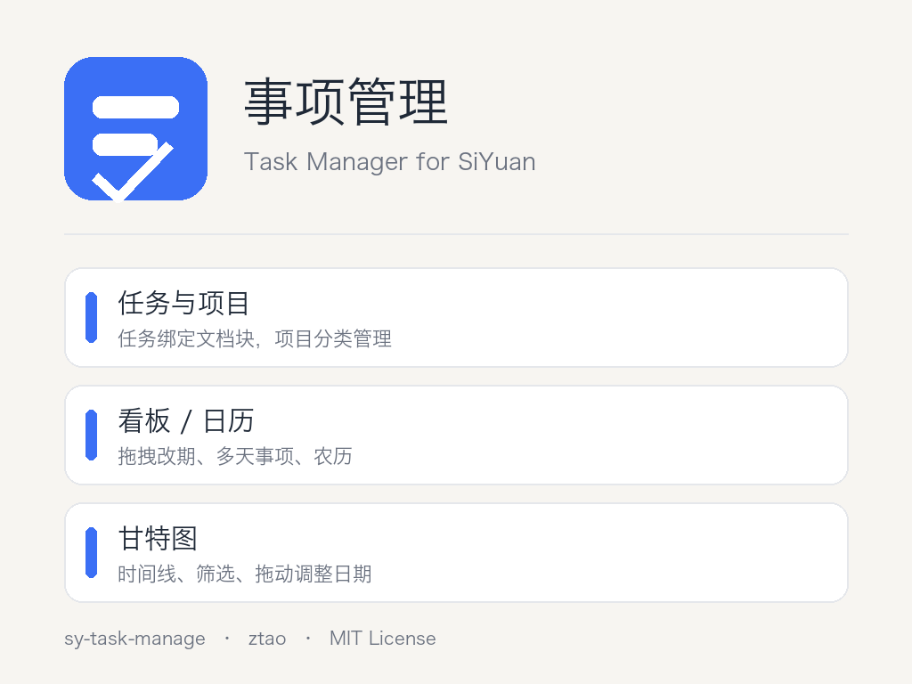

# 事项管理（sy-task-manage）

一个简洁的思源笔记事项管理插件：任务与文档块绑定，笔记、日历、看板和甘特图保持同步。

- 任务绑定文档块，标题和日期双向同步
- 项目、分类、看板、甘特图
- 月/周/列表日历，多天事项，农历
- 文档日期标题、自动移动块、空标题清理
- 可选的 Mankeep 联系人 `@` 提及
- 提醒、重复事项、导入导出、隐私模式

## 功能

- **任务与项目**：新建、编辑、完成、放弃、搜索事项；项目按分类分组。
- **块绑定**：任意块可设为事项。修改绑定块标题，或把块移动到另一个日期标题下，事项和日历/看板/甘特图会同步更新。
- **文档联动**：日历/看板新建事项时按日期写入文档；删除事项会删除绑定块和空日期标题；文档正文支持 `@` 联系人；用 `@日期` 插入日期标题后会自动删除输入的 `@日期` 文本。
- **日历**：月/周/列表视图；农历；拖动改期、拖动边缘改多天、事件前勾选完成。
- **看板**：待办 / 进行中 / 已完成 / 已放弃四列，拖拽改状态，支持分类和项目筛选。
- **甘特图**：时间线，支持搜索、排序、状态、项目/分类和完成范围筛选，拖动条带改日期。
- **自动加入日历**：日期标题下新输入的任务列表项会自动成为事项；可在设置中选择 H5/H6 标题也自动成为事项。
- **番茄钟**：在事项行点击时钟按钮、右键菜单或编辑弹窗中启动 25 分钟专注；自动 5/15 分钟休息，支持暂停/继续，并累计每个事项的番茄次数。
- **提醒**：系统通知，按天去重，重启补发。
- **重复事项**：每天 / 每周 / 每月 / 每年，支持间隔和截止日期。
- **导入导出**：JSON 导入/导出，也支持旧任务插件数据导入。
- **隐私模式**：日历和看板中的事项名、项目名逐字符显示为 `*`。



## 环境要求

- 思源笔记 **3.1.0** 或更高版本（桌面端和网页端均可）。
- 可选：名称包含 **Mankeep** 或 **人脉** 的笔记本，用于 `@` 联系人；没有该笔记本时其他功能正常，只是 `@` 列表为空。

## 安装

### 从集市安装

打开 设置 → 集市，搜索「事项管理」，安装并启用即可。启用后左侧停靠栏会出现图标。

### 手动安装

从 GitHub Release 下载 `package.zip`，解压到：

```text
{workspace}/data/plugins/sy-task-manage/
```

然后在 设置 → 集市 → 已下载 中启用「事项管理」。

## 使用

- 从侧栏、日历、看板新建事项；也可以在文档块菜单中选择 **插件 → 设为事项**。
- 点击事项标题跳转到绑定块，点击行内其他位置编辑事项。
- 在事项标题/备注或文档正文中输入 `@` 可提及 Mankeep 联系人。
- 在文档中输入 `@今天`、`@明天` 或 `@2026-11-18` 可插入/跳转日期标题。
- 底部栏可切换看板、日历和甘特图。

## 许可证

MIT，见 [LICENSE](LICENSE)。
